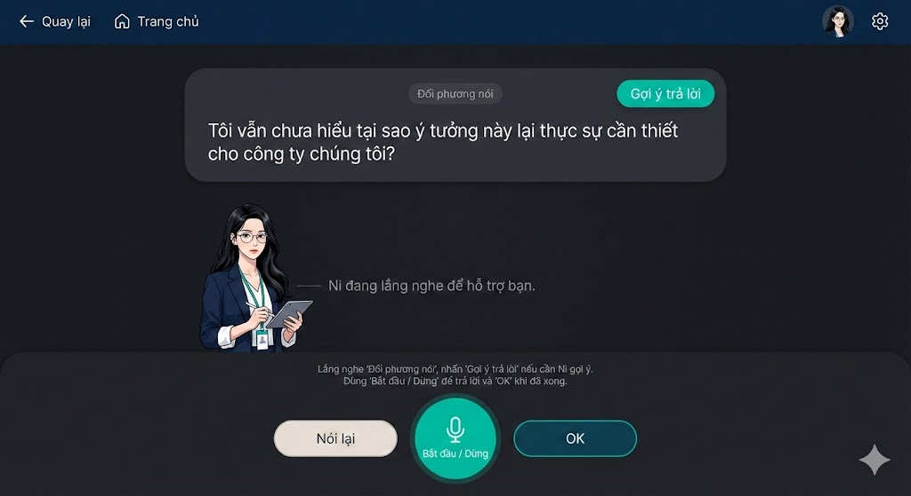
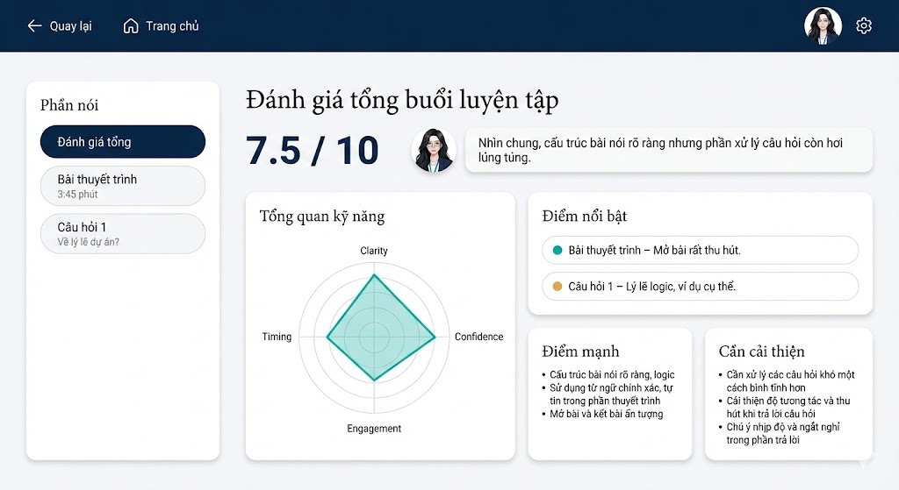
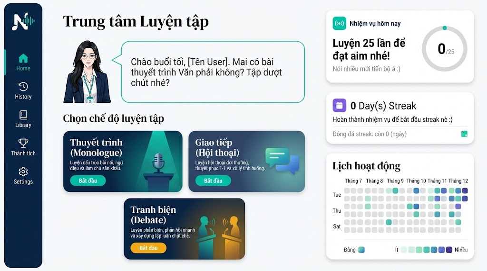

# SpeakMate: AI-Powered English Conversation Platform

[](https://speak-mate-frontend-4q8c.vercel.app)
[](LICENSE)

SpeakMate is a full-stack AI-driven web application designed to help learners practice spoken English through low-pressure, realistic scenarios with multi-agent dynamic AI feedback.

🌐 **Live Demo:** [https://speak-mate-frontend-4q8c.vercel.app](https://speak-mate-frontend-4q8c.vercel.app)

---

## 🏆 Awards & Recognitions

- 🥉 **Top 3** — **AI Young Guru 2026**
- 🥈 **Runner-up** — **Vietnam AI Contest**

---

## 📸 Product Preview

| Practice Studio (Real-Time Voice) | Assessment & Detailed Evaluation |
|:---:|:---:|
|  |  |

<p align="center">
  <em>Scenario Hub & Dashboard Overview:</em><br />
  
</p>

---

## 🏗️ System Architecture

SpeakMate is structured as a scalable monorepo comprising:

- **Frontend**: Next.js (App Router), React 19, Tailwind CSS, Framer Motion, LiveKit Web SDK / Gemini Direct audio worklets.
- **Backend Service (Control Plane)**: Node.js, Express, TypeScript, Zod, Supabase (PostgreSQL + Auth + Storage).
- **AI Engine (Data Plane)**: Modal Cloud Python worker pipeline (PhoWhisper STT, NeuTTS, Gemini 2.0/2.5 Flash LLM).
- **Shared Contracts**: `@speakmate/contracts` package sharing Zod schemas and TypeScript interfaces across frontend and backend.

```text
               ┌──────────────────────────────────────────────┐
               │              SpeakMate Frontend              │
               │            (Next.js App Router)              │
               └──────────────────────┬───────────────────────┘
                                      │
                         ┌────────────┴────────────┐
                         ▼                         ▼
            ┌─────────────────────────┐  ┌──────────────────┐
            │ Backend Service (Express│  │ Gemini Direct /  │
            │      Control Plane)     │  │ LiveKit WebSockets│
            └────────────┬────────────┘  └─────────┬────────┘
                         │                         │
                         ▼                         ▼
            ┌─────────────────────────┐  ┌──────────────────┐
            │   Supabase DB & Storage │  │  Modal Cloud AI  │
            └─────────────────────────┘  └──────────────────┘
```

---

## 📁 Repository Structure

```text
SpeakMate/
├── ai/                       # Modal Cloud Python AI worker code & pipelines
├── backend/                  # Node.js/Express API control plane server
│   ├── src/
│   │   ├── agents/           # Domain agents (Brain, Voice, Analyst, Mentor, StoryBank)
│   │   ├── controllers/      # Route controllers & orchestration
│   │   ├── middleware/       # Auth, rate limiting & error handling
│   │   ├── routes/           # Express API endpoints
│   │   └── services/         # Storage, audio, & Gemini SDK integration
├── frontend/                 # Next.js web application
│   ├── src/
│   │   ├── app/              # App Router pages (/practice, /stories, /evaluation)
│   │   ├── components/       # UI components & practice room modules
│   │   ├── context/          # React contexts (Language, Auth)
│   │   └── hooks/            # Custom hooks (Audio recording, LiveKit, Gemini Direct)
├── packages/
│   └── contracts/            # Shared TypeScript contracts & schemas
├── docs/                     # Architecture, presentation & product documentation
│   ├── presentation/         # Pitch deck & checkpoint specifications
│   └── screenshots/          # Application preview captures
├── scripts/                  # Development & utility scripts
└── package.json              # Monorepo root workspace configuration
```

---

## 🚀 Quick Start & Development

### Prerequisites
- **Node.js**: v18 or later
- **npm**: v9 or later
- **FFmpeg**: Installed and available in PATH (required for server-side audio processing)

### Installation & Setup

1. **Install dependencies across monorepo**:
   ```bash
   npm install
   ```

2. **Configure Environment Variables**:
   - Backend configuration:
     ```bash
     cp backend/.env.example backend/.env
     ```
   - Frontend configuration:
     ```bash
     cp frontend/.env.example frontend/.env.local
     ```
   - (Optional) Refer to root `.env.example` for monorepo-wide reference.

3. **Build Shared Packages**:
   ```bash
   npm run build --workspace=@speakmate/contracts
   ```

4. **Start Development Servers**:
   - Run both frontend and backend concurrently:
     ```bash
     npm run dev
     ```
   - Or start individually:
     - Frontend: `npm run dev --workspace=frontend` (Runs on `http://localhost:3000`)
     - Backend: `npm run dev --workspace=backend` (Runs on `http://localhost:3001`)

---

## 🛠️ Build & Verification

To verify full build integrity:

```bash
# Build contracts
npm run build --workspace=@speakmate/contracts

# Build backend
npm run build --workspace=backend

# Build frontend
npm run build --workspace=frontend
```

---

## 👥 Team & Roles

Developed by team **NextGents** (5 members):

- **Nguyen Le Gia Huy** ([@hyggg222](https://github.com/hyggg222)) — **Team Lead & Full-Stack AI Engineer**
  - Architected end-to-end platform design and monorepo structure.
  - Implemented Next.js 16 frontend with LiveKit WebRTC streaming and Gemini Direct audio pipelines.
  - Built Express control plane, Zod validation gates, session state isolation, and multi-agent orchestration (Brain, Voice, Analyst, Mentor Ni).
  - Configured and deployed serverless GPU pipeline on Modal Cloud (PhoWhisper STT, NeuTTS, Gemma/Gemini).
- **Nguyen Pham Hoang Lam** — **Co-founder & Product Strategy**
  - Led product concept, user journey definition, market analysis, and pitch presentations.
- **AI & NLP Research**
  - Formulated conversational prompts, STAR framework modeling, and CEFR-aligned evaluation criteria.
- **Frontend Development**
  - Collaborated on UI component integration, responsive layouts, and interactive visualizers.
- **UI/UX & Product Design**
  - Crafted design system, screen mockups, and end-to-end user experience flows.

---

## 📄 License

This project is licensed under the [MIT License](LICENSE) - see the [LICENSE](LICENSE) file for details.
